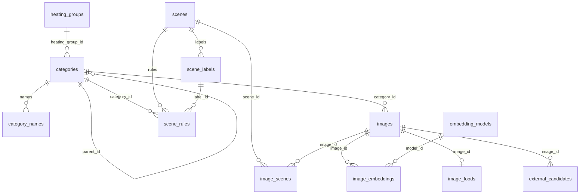

# 图搜图 PostgreSQL 数据结构

本文描述当前元数据库中实际保存的数据结构，以 `backend/app/models/` 中的 ORM 为准（共 13 张表）。向量本身不在 PostgreSQL 里，而在 Qdrant；库里只记录「哪张图、哪个模型版本已经写入过」。

数据库枚举列存的是字符串取值（`VARCHAR(32)`），取值和中文名都列在 `backend/config/param/enums.yaml`。系统枚举另有 `CHECK` 约束，取值以 `backend/app/core/enums.py` 为准；`images.source_type` / `license` 和 `image_foods.food_state` / `food_processing` 是可编辑枚举，可以通过接口 `POST /api/enums/{name}/values` 追加取值，库里不建 `CHECK`（迁移 `0004`），写入前由后端按文件校验。

---

## 总览

| 分组 | 表 | 作用 |
| --- | --- | --- |
| 图片 | `images` | 一张原图一行 |
| 图片 | `image_foods` | 图片的食物标注（非必填，每张图最多一行） |
| 图片 | `image_deletions` | 删图后的清理队列 |
| 类别 | `categories` | 类别树节点 |
| 类别 | `category_names` | 类别多语言名称与别名 |
| 类别 | `heating_groups` | 加热组 |
| 场景 | `scenes` | 应用场景 |
| 场景 | `scene_labels` | 场景自己的类别 |
| 场景 | `scene_rules` | 场景分配规则 |
| 场景 | `image_scenes` | 图片与场景的关系 |
| 向量 | `embedding_models` | 模型注册表（一个版本一行，对应一个 Qdrant collection） |
| 向量 | `image_embeddings` | 每张图已写入哪些模型版本 |
| 外部 | `external_candidates` | 外部图搜候选，审核通过后再入库 |

关系概览：

---

## 1. 图片

### 1.1 `images`

一张原图一行。`id` 由原图内容算出：字节完全相同的图只入库一次，来源只记第一次的。`id` 同时是对象存储文件名和 Qdrant 点 ID。

混入 `created_at`、`updated_at`。

| 字段 | 类型要点 | 说明 |
| --- | --- | --- |
| `id` | UUID，主键 | 原图 SHA-256 的前 16 字节 |
| `sha256` | `bytea`，唯一；长度必须为 32 字节 | 原图 SHA-256，用于校验和去重 |
| `original_url` | 文本 | 原图的完整 https 地址 |
| `thumb_url` | 文本 | 缩略图的完整 https 地址（长边 512，WebP） |
| `width` | 整数，须大于 0 | 原图宽（像素） |
| `height` | 整数，须大于 0 | 原图高（像素） |
| `source_type` | 可编辑枚举，有索引 | 来源大类，见下方枚举 |
| `license` | 可编辑枚举，有索引 | 许可标签 |
| `category_id` | 外键 → `categories.id`，`ON DELETE RESTRICT`，可空 | 可标到类别树任意层级；未标注时为空 |
| `label_status` | 枚举，有索引，默认 `unlabeled` | 标注状态。约束：`unlabeled` 当且仅当 `category_id` 为空 |
| `description` | 文本，默认空字符串 | 图片描述。只存在库里，**不进 Qdrant payload**；修改它不会让 `payload_version` 加 1 |
| `payload_version` | `bigint`，默认 1 | 类别、食物状态或所属场景变化时加 1，用来判断 Qdrant 里的 payload 要不要重推 |
| `created_at` | 时间戳 | 创建时间；图库列表按它倒序分页 |
| `updated_at` | 时间戳 | 更新时间（改食物标注时也会更新） |

食物标注（状态、加工状态、个数、质量）不在这张表里，见下面的 `image_foods`。

### 1.2 `image_foods`

图片里食物的标注，和 `image_embeddings` 一样单独成表（迁移 `0006`）。每张图最多一行（主键就是 `image_id`），图片删除时一起删。整行和每个字段都是**非必填**：没有标注的图没有这一行，读的时候六个字段都按空处理。接口读写时把这六个字段和图片放在一起（`POST /api/index` 可传；检索、列表只在 `outputs_heating` 的场景返回）。

| 字段 | 类型要点 | 说明 |
| --- | --- | --- |
| `image_id` | 主键；外键 → `images.id`，`ON DELETE CASCADE` | 图片 |
| `food_state` | 可编辑枚举，可空 | 食物状态（生 / 熟 / 冷冻），见下方枚举。**唯一进 Qdrant payload 的字段**，修改会让 `images.payload_version` 加 1 |
| `food_processing` | 可编辑枚举，可空 | 加工状态（切片 / 切块 / 整个 / 切丝……），见下方枚举 |
| `food_count` | 整数，可空；有值时须大于 0 | 食物个数 |
| `total_mass_g` | 整数（克），可空；有值时须大于 0 | 总质量 |
| `water_mass_g` | 整数（克），可空；有值时须大于等于 0 | 含水质量，可以为 0 |
| `main_ingredient_mass_g` | 整数（克），可空；有值时须大于 0 | 主食材质量 |
| `updated_at` | 时间戳 | 更新时间 |

除 `food_state` 外的五个字段只存在库里，修改不会让 `payload_version` 加 1。

### 1.3 `image_deletions`

清理队列：图片删除后，清理任务据此删掉各 collection 里的点和对象存储文件，处理完再删这条记录。图片行此时已经不在了，所以这里不设外键。

| 字段 | 类型要点 | 说明 |
| --- | --- | --- |
| `image_id` | UUID，主键 | 被删除的图片 ID |
| `original_url` | 文本 | 要清理的原图 |
| `thumb_url` | 文本 | 要清理的缩略图 |
| `deleted_at` | 时间戳，有索引，默认现在 | 删除时间；清理任务按从旧到新取 |

---

## 2. 类别

### 2.1 `heating_groups`

加热组。类别通过 `heating_group_id` 多对一映射过来，只在一体机等会输出加热信息的场景随结果给出。

| 字段 | 类型要点 | 说明 |
| --- | --- | --- |
| `id` | 自增主键 |  |
| `code` | 文本，唯一 | 加热组编码 |
| `name` | 文本 | 名称 |
| `description` | 文本，可空 | 说明。接口当前不对外暴露此字段 |

### 2.2 `categories`

类别树节点。根节点是四个域：食材、菜品、甜点烘焙、饮品；形态大类是菜品下的一层节点。层级深度、是否叶子、所属的域不单独存，查询时由 `path` 算出。`path` 由数据库维护（初始迁移启用 ltree 扩展，并用触发器在插入或移动节点时重算整棵子树，不手动写）。

混入 `created_at`、`updated_at`。

| 字段 | 类型要点 | 说明 |
| --- | --- | --- |
| `id` | 自增主键 |  |
| `code` | 文本，唯一 | 稳定编码，如 `dish.pizza`；配置和规则里用它引用类别 |
| `parent_id` | 外键 → `categories.id`，`ON DELETE RESTRICT`，可空 | 父节点；根节点为空。不能指向自己 |
| `path` | ltree，唯一，由数据库维护 | ID 链，如 `2.15.137`；有 GiST 索引 |
| `cuisines` | `text[]`，默认空数组 | 菜系，如 `{american,italian}`；子孙沿用祖先的菜系。有 GIN 索引 |
| `heating_group_id` | 外键 → `heating_groups.id`，`ON DELETE SET NULL`，可空 | 可设在任意节点；子孙没设时沿用最近祖先的 |
| `sort_order` | 整数，默认 0 | 同级排序 |
| `is_active` | 布尔，默认 true | 停用后不再用于标注 |
| `created_at` | 时间戳 | 创建时间 |
| `updated_at` | 时间戳 | 更新时间 |

四个根节点（域）的编码约定：

| 编码 | 含义 |
| --- | --- |
| `ingredient` | 食材 |
| `dish` | 菜品 |
| `dessert` | 甜点烘焙 |
| `beverage` | 饮品 |

### 2.3 `category_names`

类别名称：每种语言一个主名，可有多个别名；加语言不用改表。

主键是 `(category_id, lang, name)`。每种语言只能有一个 `kind = primary` 的主名。

| 字段 | 类型要点 | 说明 |
| --- | --- | --- |
| `category_id` | 外键 → `categories.id`，`ON DELETE CASCADE`，主键之一 | 所属类别 |
| `lang` | 文本，主键之一 | 语言代码：`zh`、`en`、`fr`、`ja` 等 |
| `name` | 文本，主键之一 | 名称 |
| `kind` | 枚举 | `primary` 主名 / `alias` 别名 |

---

## 3. 场景

### 3.1 `scenes`

应用场景，可配置新增，例如：通用、一体机、抽油烟机、美国饮食、中国饮食、日本饮食。接口传入场景编码，只在该场景的图片里检索；场景有自己的类别时，结果按场景类别给出。

混入 `created_at`。

| 字段 | 类型要点 | 说明 |
| --- | --- | --- |
| `id` | 自增主键 |  |
| `code` | 文本，唯一 | 场景编码，接口传入、写进 Qdrant payload，如 `general`、`oven` |
| `name` | 文本 | 名称，如「通用」「一体机」 |
| `description` | 文本，可空 | 说明 |
| `include_all` | 布尔，默认 false | 是否包含全部图片；通用场景为是 |
| `outputs_heating` | 布尔，默认 false | 结果是否另带加热组和食物状态；一体机场景为是 |
| `is_active` | 布尔，默认 true | 停用后不再分配新图片 |
| `created_at` | 时间戳 | 创建时间 |

### 3.2 `scene_labels`

场景自己的类别（如一体机的类别）。多个通用类别可以对应同一个场景类别。`code` 在同一场景内唯一。

| 字段 | 类型要点 | 说明 |
| --- | --- | --- |
| `id` | 自增主键 |  |
| `scene_id` | 外键 → `scenes.id`，`ON DELETE CASCADE` | 所属场景 |
| `code` | 文本 | 场景类别编码，场景内唯一，如 `steak` |
| `name` | 文本 | 名称，如「牛排」 |
| `sort_order` | 整数，默认 0 | 排序 |
| `is_active` | 布尔，默认 true | 停用后不再输出 |

另有 `(scene_id, id)` 唯一约束，供 `scene_rules` 的组合外键引用，保证规则只能映射到本场景的类别。

### 3.3 `scene_rules`

场景分配规则：按类别（含子孙）或按菜系二选一；满足任意一条即属于该场景。

按类别的规则可以带 `label_id`，把这些通用类别映射到本场景的类别。一张图被多条规则覆盖时，取类别最具体（层级最深）的那条。

约束：`category_id` 与 `cuisine` 必须恰好有一个有值；只有按类别的规则才能带 `label_id`。同一场景下，同一个类别、同一个菜系各自只能有一条规则。

| 字段 | 类型要点 | 说明 |
| --- | --- | --- |
| `id` | 自增主键 |  |
| `scene_id` | 外键 → `scenes.id`，`ON DELETE CASCADE` | 所属场景 |
| `category_id` | 外键 → `categories.id`，`ON DELETE CASCADE`，可空 | 按类别：这个类别及其所有子孙 |
| `cuisine` | 文本，可空 | 按菜系：菜系包含它的类别 |
| `label_id` | 整数，可空 | 映射到本场景自己的类别（`scene_labels`） |

`label_id` 通过组合外键 `(scene_id, label_id)` 引用 `scene_labels(scene_id, id)`。

### 3.4 `image_scenes`

图片属于哪些场景。人工记录优先，不会被规则覆盖；删掉人工记录就恢复按规则分配。`include_all` 的场景（如通用）包含全部图片，不在这里写记录。

混入 `updated_at`。主键是 `(image_id, scene_id)`。

约束：只有人工记录可以把 `is_member` 设为否（用于排除）。

| 字段 | 类型要点 | 说明 |
| --- | --- | --- |
| `image_id` | 外键 → `images.id`，`ON DELETE CASCADE`，主键之一 | 图片 |
| `scene_id` | 外键 → `scenes.id`，`ON DELETE CASCADE`，主键之一 | 场景 |
| `origin` | 枚举 | `rule` 按规则分配 / `manual` 人工调整 |
| `is_member` | 布尔，默认 true | 是否属于该场景；人工排除时为否 |
| `updated_at` | 时间戳 | 更新时间 |

---

## 4. 模型与向量写入记录

### 4.1 `embedding_models`

模型注册表：一个模型版本一行，对应一个 Qdrant collection。

切换方式：新版本补齐后改为 `ready`，再设为 `current`，旧版本退回 `ready`；回滚就是把旧版本设回 `current`。查询编码器和 collection 必须成对切换。同一时间只能有一个 `current`。

混入 `created_at`。`name` + `version` 唯一；`collection` 唯一；`dim` 和 `input_size` 必须大于 0。

| 字段 | 类型要点 | 说明 |
| --- | --- | --- |
| `id` | 自增主键 |  |
| `name` | 文本 | 模型名，如 `dinov3_vith16plus_lora` |
| `version` | 文本 | 版本 |
| `dim` | 整数 | 向量维度，如 1024 |
| `distance` | 枚举 | 距离：`cosine` / `dot` / `euclid` |
| `input_size` | 整数 | 输入尺寸，如 336 |
| `preprocess` | `jsonb`，默认 `{}` | 预处理参数：均值方差、缩放方式等 |
| `weights_uri` | 文本 | 权重位置，含 LoRA |
| `collection` | 文本，唯一 | 对应的 Qdrant collection 名 |
| `status` | 枚举，默认 `building` | `building` / `ready` / `current` / `retired` |
| `activated_at` | 时间戳，可空 | 切换为当前的时间 |
| `created_at` | 时间戳 | 创建时间 |

### 4.2 `image_embeddings`

每张图已经写进了哪些模型版本的 collection。主键是 `(model_id, image_id)`。

| 字段 | 类型要点 | 说明 |
| --- | --- | --- |
| `model_id` | 外键 → `embedding_models.id`，`ON DELETE CASCADE`，主键之一 | 模型版本 |
| `image_id` | 外键 → `images.id`，`ON DELETE CASCADE`，主键之一 | 图片 |
| `synced_version` | `bigint` | 写入 Qdrant 时这张图的 `payload_version`；和图片当前值不一致就要重推 payload |
| `embedded_at` | 时间戳，默认现在 | 写入时间 |

---

## 5. 外部图搜候选

### 5.1 `external_candidates`

外部图搜结果先存这里等人工审核，不写进 Qdrant。通过后作为 `source_type` 为 `external` 的普通图片入库。

混入 `created_at`。同一服务的同一原链接只存一次。待审核时 `reviewed_at` 必须为空；只有审核通过后才能有 `image_id`。

| 字段 | 类型要点 | 说明 |
| --- | --- | --- |
| `id` | UUID，主键，默认 `gen_random_uuid()` |  |
| `provider` | 文本 | 外部图搜服务名 |
| `source_url` | 文本 | 结果原链接 |
| `staged_url` | 文本 | 暂存文件的完整 https 地址（对象存储 `staging/`） |
| `external_label` | 文本，可空 | 外部返回的标签文字，审核时参考 |
| `query_ref` | 文本，可空 | 触发这次搜索的查询，如请求 ID |
| `review_status` | 枚举，默认 `pending` | `pending` / `accepted` / `rejected` |
| `reviewed_at` | 时间戳，可空 | 审核时间；待审核时为空 |
| `image_id` | 外键 → `images.id`，`ON DELETE SET NULL`，可空 | 入库后的图片 ID；未入库时为空 |
| `created_at` | 时间戳 | 创建时间 |

---

## 6. 枚举取值

取值的权威是 `backend/config/param/enums.yaml`（接口 `GET /api/enums` 返回同样的内容）。下表是初始取值：可编辑枚举运行中可能多出新取值，以文件为准。

| 枚举（文件里的名字） | 字段 | 类型 | 取值 |
| --- | --- | --- | --- |
| `source_type` | `images.source_type` | 可编辑，无 CHECK | `crawled` 爬取（含 TikTok、Instagram）；`device` 设备采集；`open_dataset` 开源数据集；`user_upload` 用户上传（默认）；`external` 外部图搜审核通过 |
| `license` | `images.license` | 可编辑，无 CHECK | `commercial` 可商用；`research_only` 仅研究；`unknown` 未知（默认） |
| `food_state` | `image_foods.food_state` | 可编辑，无 CHECK | `raw` 生；`cooked` 熟；`frozen` 冷冻 |
| `food_processing` | `image_foods.food_processing` | 可编辑，无 CHECK | `sliced` 切片；`chunked` 切块；`whole` 整个；`shredded` 切丝 |
| `name_kind` | `category_names.kind` | 系统，CHECK | `primary` 主名；`alias` 别名 |
| `label_status` | `images.label_status` | 系统，CHECK | `unlabeled` 未标注（一定没有类别）；`auto` 自动标注；`verified` 已核验 |
| `scene_origin` | `image_scenes.origin` | 系统，CHECK | `rule` 按规则分配；`manual` 人工调整（优先于规则） |
| `distance` | `embedding_models.distance` | 系统，CHECK | `cosine`；`dot`；`euclid` |
| `model_status` | `embedding_models.status` | 系统，CHECK | `building` 正在写入向量；`ready` 已补齐，可以切换；`current` 当前使用；`retired` 已下线 |
| `review_status` | `external_candidates.review_status` | 系统，CHECK | `pending`；`accepted`；`rejected` |

`category_domain`（类别树的四个根节点：食材、菜品、甜点烘焙、饮品）也在文件里，不对应数据库字段。

---

## 7. 与 Qdrant 的边界

- PostgreSQL 保存元数据、类别树、场景归属和向量写入记录。
- Qdrant 保存向量和检索用 payload。
- 图片的 `id` 同时是 Qdrant 点 ID。
- `images.description` 和 `image_foods` 里除 `food_state` 以外的字段不写入 Qdrant payload；`food_state` 写入，取自 `image_foods`。
- `images.payload_version` 与 `image_embeddings.synced_version` 对照：不一致则需要重推 payload。
- `embedding_models.collection` 指出该模型版本对应的 Qdrant collection；同一时间只有一个 `current` 模型对外提供检索。